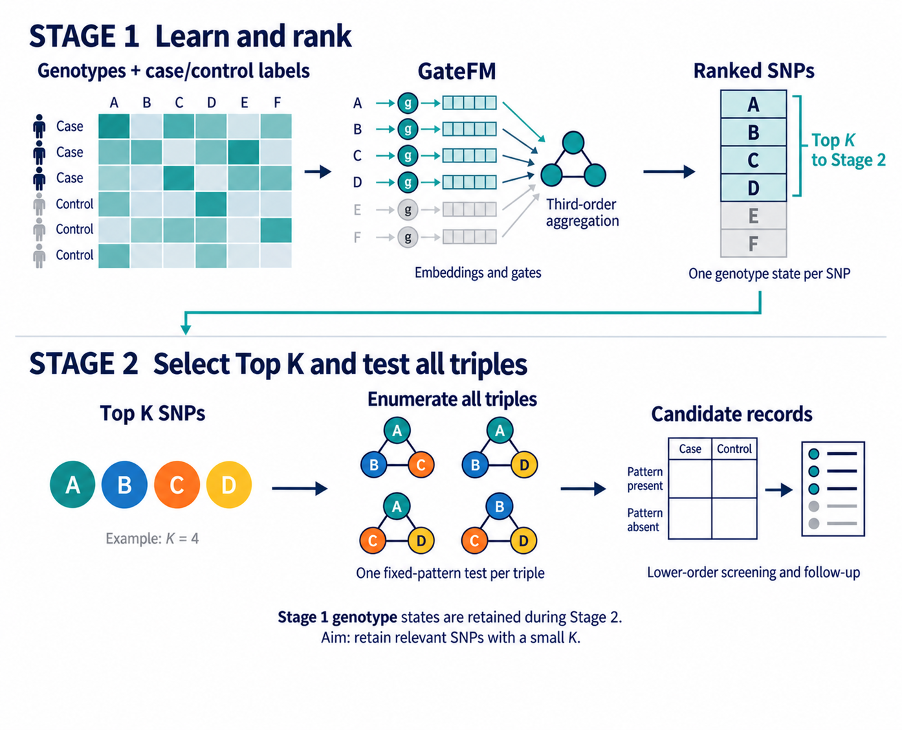

# hypertension-snp — GateFM

Method documentation for

> Huang S-H, Wang Y-C, Yunanto RA, Leu J-S, Tsai C-T.
> **Supervised Third-Order Factorization for High-Dimensional Three-SNP Hypothesis Prioritization in Hypertension.**

and the NTUST master's thesis *Epistasis Detection in High-Dimensional SNP Data* (Shih-Hung Huang, 2026).

> **Status:** this repository currently holds the **documentation of the complete method** — model,
> statistics, datasets, experimental protocol and reference results. The source code was run by the
> original author and will be added here when released. [docs/API.md](docs/API.md) is the implementation
> specification the code is expected to follow.

## What GateFM does

GateFM is a **gated third-order factorization machine** that ranks SNPs by their participation in
third-order (three-locus) interactions without enumerating the `C(P,3)` triples. A second stage
then exhaustively tests every triple among the top-`K` SNPs with one model-specified genotype pattern
per triple.

```
(X, y) ──Stage 1: GateFM SNP ranking──▶ R ──Stage 2: top-K triple tests──▶ T
          O(P·r) per sample                     C(K,3) 2×2 tables
```

For the 14,313-SNP hypertension cohort, `C(14313,3) ≈ 4.89 × 10¹¹` triples are reduced to
`C(30,3) = 4,060` explicit records.



### Pipeline in 7 steps

1. **Encode** — genotype matrix `X ∈ {0,1,2}^{n×P}` treated as categorical states (one embedding per SNP per genotype).
2. **Train Stage 1** — GateFM: gated embeddings → factorized third-order term → logit; loss = BCE + gate-count penalty.
3. **Rank SNPs** — score `q_j = max_k g_j‖v_{j,k}‖₂`; sort descending (cohort: mean rank over 10 fits).
4. **Select top-K** — `S_K` = first `K` SNPs (`K = 30` reporting width).
5. **Fix patterns** — representative genotype `k̂_j = argmax_k g_j‖v_{j,k}‖₂` per selected SNP.
6. **Test triples** — every `C(K,3)` triple → one 2×2 table → χ² p, Bonferroni p, OR (95% CI).
7. **Report** — triples sorted by p, filtered by the lower-order screen (`2 × 10⁻⁴`).

## Documentation

| Doc | Contents |
|---|---|
| [docs/METHOD.md](docs/METHOD.md) | Full method: equations, FM trick, gates, losses, scoring, Stage 2 statistics, metrics |
| [docs/DATASETS.md](docs/DATASETS.md) | GAMETES benchmark spec, Taiwan Biobank cohort, data formats, reference records |
| [docs/EXPERIMENTS.md](docs/EXPERIMENTS.md) | Hyperparameters, experimental protocol, reference results (Tables 1–3, ablation) |
| [docs/API.md](docs/API.md) | Implementation specification: planned modules, functions, outputs, config schema |

## Repository layout

```
hypertension-snp/
├── README.md
├── CITATION.cff
└── docs/
    ├── METHOD.md
    ├── DATASETS.md
    ├── EXPERIMENTS.md
    ├── API.md
    └── figures/          # fig1_workflow, fig2_runtime, figS1_ablation, figS2_pvalues
```

The planned code layout (`gatefm/`, `configs/`, `scripts/`) is described in [docs/API.md](docs/API.md).

## Reported environment

| Item | Version / spec |
|---|---|
| Python | 3.11.12 |
| PyTorch | 2.9.1+cu128 (CUDA 12.8) |
| NumPy / pandas / SciPy / scikit-learn | 2.4.3 / 3.0.1 / 1.17.1 / 1.8.0 |
| Hardware | AMD Ryzen 7 9700X (8 cores), NVIDIA RTX 5070 (12 GB), 64 GB RAM |

## Data availability

- **Synthetic benchmark** — not distributed; regenerate with GAMETES using [docs/DATASETS.md](docs/DATASETS.md).
- **Taiwan Biobank hypertension cohort** — controlled access. Individual-level data **must not be committed**
  to this repository. Apply via <https://www.twbiobank.org.tw> (ethics: NTUH REC 201606128RINC).

## Citation

See [CITATION.cff](CITATION.cff). Archived release DOI: *[to confirm]*.

## License

*[to confirm]*
